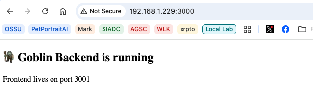
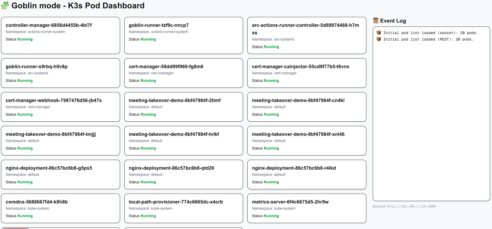

# 🧌 Goblin ARC Dashboard

A lightweight, real-time dashboard for watching Kubernetes pods without the overhead of large monitoring tools.

---

## 🧠 What This Is

Goblin ARC Dashboard is a simple full-stack app that:

* Connects to a Kubernetes cluster
* Tracks pods across namespaces
* Streams updates in real time
* Displays everything in a clean UI

It’s built for quick visibility and fast feedback — not enterprise bloat.

---

## ⚙️ How It Works

The app has two parts:

* **Backend (port 3000)**
  Handles Kubernetes communication and streams updates

  

* **Frontend (port 3001)**
  Displays the dashboard UI

  

👉 You only need to open the frontend in your browser.

---

## 🚀 Getting Started

### 1. Clone the repo

```bash
git clone https://github.com/the-robots/goblin-arc-dashboard.git
cd goblin-arc-dashboard
```

---

### 2. Install dependencies

From the repo root, install both backend and frontend dependencies:

```bash
npm run install:all
```

---

### 3. Start the app

From the repo root, start both the backend and frontend with a single command:

```bash
npm run dev
```

This launches the backend (port 3000) and frontend (port 3001) simultaneously using `concurrently`.

---

### 4. Open the dashboard

```text
http://<your-server-ip>:3001
```

Example:

```text
http://192.168.1.229:3001
```

---

## 🔄 Real-Time UI Updates

The dashboard updates **dynamically in real time** — no page reloads required.

### How it works

1. **Kubernetes Watch (backend)**
   The backend uses the Kubernetes Watch API to subscribe to pod events across all namespaces. Whenever a pod is added, modified, or deleted, Kubernetes pushes the change to the backend immediately.

2. **WebSocket Push (backend → frontend)**
   The backend runs a [Socket.IO](https://socket.io/) server. When it receives a pod event from the Kubernetes watch, it broadcasts a `pods:update` message to every connected browser over a persistent WebSocket connection.

3. **Live React State (frontend)**
   The frontend connects to the backend WebSocket on page load. Incoming `pods:update` events are applied directly to React state, which causes the UI to re-render instantly:

   * **Kube Blocks** — Pod cards appear, disappear, or update their status in place as pods are added, deleted, or modified.
   * **Event Log** — Each change is prepended to the log with a color-coded icon (🟢 added, 🟡 modified, 🔴 deleted), giving you a live feed of cluster activity.

Because updates flow through a persistent WebSocket rather than polling or page refreshes, the dashboard reflects cluster changes within moments of them happening.

---

## ⚠️ Important Notes

* **Port 3001 = dashboard UI**
* **Port 3000 = backend only**

If you open port 3000 in a browser, you may see a placeholder page or raw output — this is expected.

---

## 🧌 Requirements

* Access to a Kubernetes cluster
* A valid kubeconfig file

By default, this project is configured for k3s using:

```
/etc/rancher/k3s/k3s.yaml
```

If you are using standard Kubernetes, update the kubeconfig path in `server.js`:

```js
kc.loadFromFile('/path/to/your/kubeconfig');
```

Alternatively, you can modify it to use your default kubeconfig:

```js
kc.loadFromDefault();
```

---

## 🧌 Final Words

This is a fast, scrappy dashboard for seeing what your cluster is doing right now.

If it works — don’t touch it.
If it breaks — welcome back to goblin mode.

---
