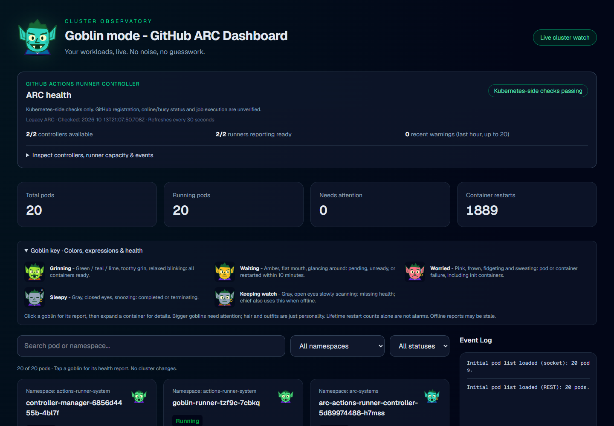
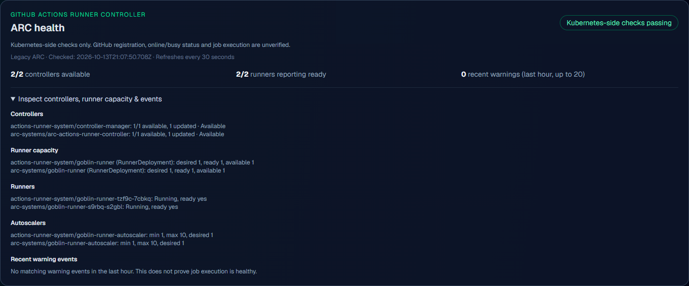
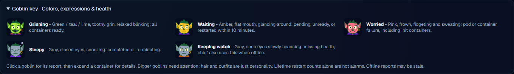
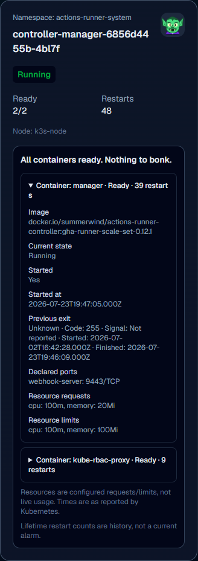
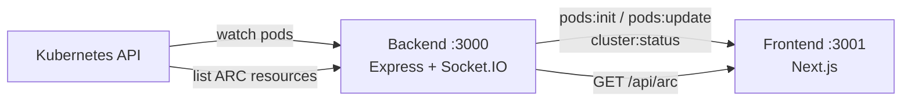

# 🧌 Goblin GitHub ARC Dashboard

A lightweight, real-time health dashboard for GitHub Actions Runner Controller (ARC) without the overhead of large monitoring tools. Goblins reflect the health of every pod in the cluster.



---

## 🧠 What This Is

Goblin GitHub ARC Dashboard is a small full-stack app that:

* Connects to the Kubernetes cluster that hosts ARC
* Checks ARC controller, runner, and autoscaler health
* Tracks pods across all namespaces and streams changes live
* Shows each pod's health through goblins whose color, face, and animation change with its state
* Lets you click a goblin for a per-container health report

It's built for quick visibility and fast feedback, not enterprise bloat.

The dashboard uses the standard Kubernetes API, so ARC can run on any
conformant Kubernetes distribution (K3s, AKS, EKS, GKE, kind, and others).
It monitors one cluster/context per backend instance; simultaneous multi-cluster
monitoring is not currently supported.

---

## ✨ Features

### ARC health



The ARC panel summarizes the whole ARC installation:

* **Controllers:** deployment availability and observed rollout
* **Runner capacity:** desired, ready, and available replicas per RunnerDeployment
* **Runners:** phase and readiness of each runner
* **Autoscalers:** HorizontalRunnerAutoscaler min, max, and desired replicas
* **Warning events:** ARC-related warnings from the last hour (up to 20)

It discovers legacy ARC (`actions.summerwind.dev`) and scale-set CRDs
(`actions.github.com`). Scale-set resource counts are informational and stay
**unknown** rather than being labeled healthy. Missing permissions or read failures
also produce **unknown**, never a green result. Zero runners can be intentional,
so scale-to-zero is not an error. The panel refreshes every 30 seconds, and the
backend shares snapshots for 15 seconds.

> [!NOTE]
> These are **Kubernetes-side checks**. They don't prove GitHub registration,
> online/busy status, authentication, autoscaling reconciliation, or successful
> job execution. Controller discovery uses known deployment names and labels, so
> nonstandard installations may not be detected.

### Goblin key



Every pod gets a goblin. Its color, expression, and animation show health at a glance:

| Mood | Look | Meaning |
|---|---|---|
| **Grinning** | Green / teal / lime, toothy grin, blinks and bobs | All containers ready |
| **Waiting** | Amber, flat mouth, glances around | Pending, unready, or a container restarted in the last 10 minutes |
| **Worried** | Pink, frown, fidgets and sweats | Pod or container failure, including init containers |
| **Sleepy** | Gray, closed eyes, snoozing Zs | Completed or terminating |
| **Keeping watch** | Gray, open eyes slowly scanning | Health data missing; the chief goblin also uses this when offline |

* Healthy goblins are small; goblins that need attention are larger.
* Hair, outfits, and accessories are seeded per pod for variety and carry no meaning.
* Lifetime restart counts alone don't trigger an alarm.
* The chief goblin in the header reflects overall cluster health.
* Each goblin starts its animation at a different point, so cards don't move in sync.
* All animations turn off when the OS requests reduced motion.

### Goblin health reports and container details



Click a goblin to toggle its health report (one open at a time). Expand any
container, including init containers, to see:

* Image
* Readiness and restart count
* Current state and message, started flag, and start time
* Current and previous exit (code, signal, reason, message, times)
* Declared ports
* Resource requests and limits

Configured containers without a status are also listed. Resource values are
configuration, not live CPU/memory usage, and timestamps are shown as Kubernetes
reports them. Environment variables and credentials are never displayed.

### Live pod view

* Summary cards for total, running, needs-attention pods, and container restarts
* Search plus namespace and status filters
* Ready and restart counts, waiting reasons, and node name per pod
* A bounded 50-entry event log (🟢 added, 🟡 modified, 🔴 deleted)
* Explicit connection and watch errors; disconnected data is marked as possibly stale
* Pods identified by namespace and name, so identical names in different namespaces stay distinct

<br clear="right">

---

## 📋 Requirements

| Requirement | Version | Description | Link |
|---|---|---|---|
| **Kubernetes cluster** | 1.24+ | Any conformant distribution running ARC. K3s works well for local labs. | [Kubernetes](https://kubernetes.io/) · [K3s](https://k3s.io/) |
| **Actions Runner Controller** | Legacy or scale-set | The ARC installation to monitor. Without ARC, the panel reports "ARC not detected" and pod monitoring still works. | [ARC docs](https://docs.github.com/actions/hosting-your-own-runners/managing-self-hosted-runners-with-actions-runner-controller/about-actions-runner-controller) |
| **Node.js** | 18.18 or later | Runtime for the backend and frontend. | [nodejs.org](https://nodejs.org/) |
| **npm** | 9 or later | Ships with Node.js. | [npmjs.com](https://www.npmjs.com/) |
| **kubeconfig** | — | Credentials for the cluster. | [kubeconfig docs](https://kubernetes.io/docs/concepts/configuration/organize-cluster-access-kubeconfig/) |
| **kubectl** *(optional)* | — | Useful for verifying access first. | [Install kubectl](https://kubernetes.io/docs/tasks/tools/#kubectl) |

The kubeconfig needs read-only list access to pods, deployments, events, CRDs,
and the installed ARC custom resources across all namespaces. The dashboard never
writes to the cluster.

---

## 🚀 Getting Started

### 1. Clone and install

```bash
git clone https://github.com/the-robots/goblin-arc-dashboard.git
cd goblin-arc-dashboard
npm run install:all
```

### 2. Start both servers

```bash
npm run dev
```

The backend uses `KUBECONFIG` when set, otherwise `~/.kube/config`. Set
`KUBE_CONTEXT` to override the file's current context. It exits with an error
when no cluster is configured.

To run the servers separately:

```bash
# Backend (from repo root)
node server.js

# Frontend
cd frontend
npm run dev -- --hostname 127.0.0.1 --port 3001
```

### 3. Open the dashboard

```text
http://localhost:3001
```

Port 3001 is the dashboard UI. Port 3000 is the backend only.

### Local Windows + Hyper-V K3s example

For a K3s VM on Hyper-V, place a dedicated kubeconfig at
`$HOME\.kube\goblin-k3s.yaml`. Replace its loopback API server address
(`https://127.0.0.1:6443`) with the VM's reachable hostname or IP, which must also
match the API server certificate. Keep TLS verification on and keep credentials
outside this repository.

```powershell
npm.cmd run install:all
npm.cmd run start:local
```

`start:local` uses that file unless `KUBECONFIG` is already set, and it doesn't
change your kubectl current context. To use another file:

```powershell
$env:KUBECONFIG = 'C:\path\to\kubeconfig'
npm.cmd run start:local
```

> [!TIP]
> If PowerShell blocks `npm` with an execution-policy error, use `npm.cmd` as shown.

---

## ⚙️ Configuration

| Variable | Applies to | Default | Purpose |
|---|---|---|---|
| `KUBECONFIG` | Backend | `~/.kube/config` | Kubeconfig file to load |
| `KUBE_CONTEXT` | Backend | File's current context | Context to use |
| `HOST` | Backend | `127.0.0.1` | Bind address |
| `PORT` | Backend | `3000` | Backend port |
| `FRONTEND_ORIGIN` | Backend | `http://localhost:3001` | Allowed CORS origin for the UI |
| `NEXT_PUBLIC_BACKEND_URL` | Frontend | `http://localhost:3000` | Backend URL the browser connects to |

Both servers bind to loopback by default. For deliberate LAN use, set `HOST` and
`FRONTEND_ORIGIN` on the backend and `NEXT_PUBLIC_BACKEND_URL` on the frontend,
then start the frontend with the desired `--hostname`.

> [!WARNING]
> The dashboard has no authentication. Don't expose it to untrusted networks.

---

## 🔄 How It Works



1. **Kubernetes watch:** the backend lists pods, then watches from that snapshot's
   resource version. Dropped watches retry automatically.
2. **WebSocket push:** changes are broadcast to every connected browser over Socket.IO.
3. **Live React state:** the UI applies each change in place. Updates that arrive
   before the initial snapshot are buffered and replayed, so nothing is lost.
4. **ARC polling:** the ARC panel fetches `/api/arc` every 30 seconds.

### Backend API

| Endpoint / event | Description |
|---|---|
| `GET /healthz` | Liveness check |
| `GET /api/pods` | Current pod list |
| `GET /api/arc` | ARC health summary (selected status fields only; never registration tokens or secrets) |
| `pods:init` | Socket event with the full pod list |
| `pods:update` | Socket event with `{ type, pod }` for ADDED, MODIFIED, or DELETED |
| `cluster:status` | Socket event with watch connection state |
| `pods:error` | Socket event when the pod list can't be fetched |

---

## 🧪 Testing

```bash
npm test                    # backend
npm --prefix frontend test  # frontend
npm --prefix frontend run lint
```

---

## 🧌 Final Words

This is a fast, scrappy dashboard for seeing what your ARC runners are doing right now.

If it works, don't touch it.
If it breaks, welcome back to goblin mode.
